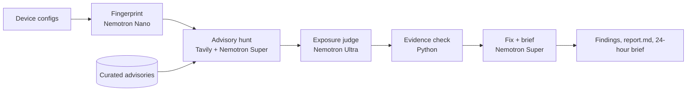

# ExposureLens

**Version scanners say you're vulnerable. Your config says whether you're exposed.**

[](LICENSE)


[](https://github.com/users/natrajexplore/packages/container/package/exposurelens)

ExposureLens is a multi-agent app for network security teams. You upload device configs
(Cisco IOS-XE, Cisco Secure Firewall Threat Defense (FTD), Cisco ISE on ADE-OS, Palo Alto
PAN-OS). Agents find the security advisories that apply,
decide for each device whether the vulnerable feature is actually configured, cite the exact
config lines that prove it, and draft a mitigation with verify and rollback commands.

Built for the **Nebius x NVIDIA Global AI Hackathon** — *Best Apps and Agents* track.
Powered by **NVIDIA Nemotron 3 (Nano, Super, Ultra) on Nebius Token Factory**, with **Tavily**
for live advisory discovery. MIT licensed.

**Contents:** [Problem](#the-problem) · [Results](#results-on-the-sample-fleet) ·
[Platforms](#supported-platforms-and-curated-advisories) · [How it works](#how-it-works) ·
[Verdicts](#how-a-verdict-is-decided) · [Performance](#measured-cost-and-latency) ·
[Quick start](#quick-start) · [Docker](#run-with-docker) ·
[Local domain](#run-on-a-local-domain-optional) · [Configuration](#configuration) · [API](#api) ·
[Troubleshooting](#troubleshooting) · [Changelog](#changelog) · [Roadmap](#roadmap)

---

## The problem

Most critical network-device CVEs only matter if a specific feature is turned on: the IOS-XE
Web UI bug needs `ip http server`, the PAN-OS GlobalProtect bug needs a GlobalProtect portal or
gateway. Version-based scanners flag every device on an affected version, so engineers spend
the first hours of every emergency advisory opening configs one by one to find out which
devices are really exposed. ExposureLens does that triage in minutes, with evidence.

## Results on the sample fleet

Six synthetic devices ship in [`samples/configs/`](samples/configs). Three pairs show the
point: same version, different exposure. A version scanner flags every one of them. A live scan:

| Device | OS | Advisory | Verdict | Proof (verified config line) |
|---|---|---|---|---|
| `edge-rtr-01` | IOS-XE 17.06.05 | CVE-2023-20198 Web UI | **EXPOSED** | L32 `ip http server` |
| `branch-rtr-02` | IOS-XE 17.06.05 | CVE-2023-20198 Web UI | **NOT EXPOSED** | L22 `no ip http server` |
| `ftd-vpn-01` | FTD 7.2.5 | CVE-2025-20333, CVE-2025-20362 VPN web server | **EXPOSED** | L30–33 `webvpn` / `enable outside` / `anyconnect enable` |
| `ftd-dc-01` | FTD 7.2.5 | CVE-2025-20333, CVE-2025-20362 VPN web server | **NOT EXPOSED** | L28 no webvpn, AnyConnect or remote-access tunnel-group |
| `ise-01` | ISE 3.3.0.430 Patch 4 | CVE-2025-20281, CVE-2025-20337 unauthenticated RCE | **EXPOSED** | L16, L22 version and Patch 4 (fixed in Patch 7; any config) |
| `ise-01` | ISE 3.3.0.430 Patch 4 | CVE-2025-20286 cloud static credential | **NOT EXPOSED** | L26–27 on-premises VMware, not AWS/Azure/OCI |
| `fw-edge-01` | PAN-OS 11.1.2 | CVE-2024-3400 GlobalProtect | **EXPOSED** | L14 GlobalProtect portal on `ethernet1/1` (untrust) |
| `fw-edge-01` | PAN-OS 11.1.2 | CVE-2024-0012, CVE-2025-0111 mgmt interface | **NOT EXPOSED** | L18 management profile allows ping only |

Live runs also surface newer advisories; each run's set varies with what Tavily finds.
For every EXPOSED finding the app drafts an interim mitigation, verification and rollback
commands, and a permanent fix, plus a 24-hour brief for the whole fleet.

## Supported platforms and curated advisories

Live Tavily search finds current advisories for any of these platforms. A small curated pack
of verified advisories is always judged as well, so the most important cases never depend on
what search returns that day.

| Platform | Detected from | Sample devices | Curated advisories (always checked) | Exposure depends on |
|---|---|---|---|---|
| Cisco IOS-XE | `Cisco IOS XE Software, Version` | `edge-rtr-01`, `branch-rtr-02` | CVE-2023-20198 / 20273 Web UI (critical, KEV) | `ip http server` / `ip http secure-server` |
| Cisco Secure Firewall Threat Defense (FTD) | `NGFW Version` banner | `ftd-vpn-01`, `ftd-dc-01` | CVE-2025-20333 VPN web server RCE (critical, KEV); CVE-2025-20362 unauthorized access (KEV) | AnyConnect SSL VPN / IKEv2 remote access on a reachable interface |
| Cisco ISE on ADE-OS | `show version`: ISE version and patch | `ise-01` | CVE-2025-20281 / 20337 unauthenticated RCE (CVSS 10, KEV); CVE-2025-20286 cloud static credential | RCE: version and patch only (any config). Credential bug: Primary Admin node in AWS, Azure or OCI |
| Palo Alto PAN-OS | `sw-version:` | `fw-edge-01` | CVE-2024-3400 GlobalProtect (critical, KEV) | GlobalProtect portal or gateway |

All sample configs are synthetic: documentation and private IP ranges, fake serials and hashes.

## How it works



| Stage | Model | Why this tier |
|---|---|---|
| Fingerprint every config: OS, version, enabled features, proof lines | **Nemotron 3 Nano** | High-volume structured extraction; runs once per device in parallel |
| Turn live Tavily results from vendor PSIRT / CISA into structured advisories (affected versions, vulnerable feature, exploit conditions, workaround) | **Nemotron 3 Super** | Long-context reading of many sources; output is source-checked (every advisory URL must come from Tavily results, and version ranges must be quoted from the source). Curated advisories are always judged and take precedence on overlapping CVEs; live results add the rest |
| Decide EXPOSED / NOT_EXPOSED / NEEDS_REVIEW for each device × advisory | **Nemotron 3 Ultra** | The hard reasoning step: version range + feature presence + reachability + existing mitigations |
| Verify every cited config line exists in the file | Python | The model never gets the last word on evidence. An EXPOSED verdict with no verifiable lines is downgraded to NEEDS_REVIEW |
| Draft interim mitigation, verification, rollback, permanent fix; write the 24-hour brief | **Nemotron 3 Super** | Structured drafting at a fraction of Ultra's cost |

The UI shows a live **"Which Nemotron did what"** table: calls, tokens, latency and estimated
cost per tier, compared to running every call on Ultra.

**Safety by design:** ExposureLens is read-only. It never connects to or changes a device.
All commands are labelled as drafts for human review in your change process.

## How a verdict is decided

1. **Deterministic facts first.** Python parses vendor, OS, version and hostname from the
   config. These override anything the model says (`app/config_tools.py`).
2. **Ultra judges against strict rules** (`app/prompts.py`):
   - Version match alone is never exposure; the vulnerable feature must be configured.
   - A *related* setting is not evidence: a management profile that only permits ping does
     not expose the management web interface.
   - If the advisory names specific builds and the config version is less precise, the
     verdict can be at most NEEDS_REVIEW.
   - If the advisory applies regardless of configuration (like the ISE RCE), a verified
     version and patch match is enough.
3. **Python checks the evidence.** Each cited line must exist in the file (line numbers are
   corrected if the text is found elsewhere); fabricated lines are discarded, and EXPOSED
   without verified evidence becomes NEEDS_REVIEW.
4. **A transparent risk score** (0–100) orders the findings: severity weight × verdict, plus
   points for CISA KEV and internet-facing services.

## Measured cost and latency

Real scans of the sample fleet, from the app's own ledger. Costs are estimates from per-token
list prices (`PRICE_*` in `.env` to update).

| Run | Verdicts | Calls | Time | Est. cost | vs all-Ultra | Avg latency Nano / Super / Ultra |
|---|---|---|---|---|---|---|
| **Current 6-device fleet, live + curated** | 11 | 27 | 42 s | $0.024 | 60.2% cheaper | 4.0 / 3.2 / 2.1 s |
| Earlier 4-device fleet, curated only | 4 | 12 | 17 s | $0.008 | 59.5% cheaper | 4.9 / 3.9 / 1.8 s |
| Earlier 4-device fleet, live | 6 | 17 | 30 s | $0.014 | 66.0% cheaper | 4.5 / 3.7 / 2.3 s |
| Earlier 4-device fleet, live + curated, in Docker | 12 | 25 | 65 s | $0.023 | 54.4% cheaper | 3.9 / 3.3 / 10.4 s |

Latency varies a lot between runs. Ultra was the fastest tier in most runs (about 2 s per
verdict) but averaged 10.4 s in the largest one, so verdicts run in parallel (4 workers) to
keep scan time down.

## Where Nebius Token Factory helped

- One OpenAI-compatible endpoint for all three Nemotron tiers, so tier routing is a one-line model swap (`app/llm.py`).
- Nano fingerprinting and Ultra judging run in parallel threads against the same endpoint, so scan time grows slowly with fleet size.
- Token Factory's per-token pricing made it practical to reserve Ultra only for verdicts.
- JSON mode (`response_format: json_object`) returned parseable JSON on all three tiers.
- `jobs/nightly_scan.py` runs the same pipeline as a batch job (container-ready for Nebius Serverless Jobs) so new advisories are caught overnight.

## Quick start

You need a [Nebius Token Factory](https://tokenfactory.nebius.com) API key (the
[Nebius Builder Program](https://dev.nebius.com/builders) gives free credits). A
[Tavily](https://app.tavily.com) key is optional; without it, advisories come from the bundled
curated pack, clearly labelled in the UI.

With [uv](https://docs.astral.sh/uv/) (recommended):

```bash
git clone https://github.com/natrajexplore/exposurelens && cd exposurelens
uv sync
cp .env.example .env          # add NEBIUS_API_KEY (and optionally TAVILY_API_KEY)
uv run python scripts/list_models.py --test   # checks all three Nemotron tiers answer
uv run uvicorn app.main:app --reload
```

On Windows **Command Prompt** (after `uv sync` and creating `.env` as above):

```bat
cd /d "C:\path\to\exposurelens"
uv run uvicorn app.main:app --host 127.0.0.1 --port 8000
```

Keep that window open (minimised) while you use the app; press **Ctrl+C** to stop it. The
FastAPI backend serves the web UI too, so this one command runs both.

With pip:

```bash
git clone https://github.com/natrajexplore/exposurelens && cd exposurelens
python -m venv .venv && source .venv/bin/activate      # Windows: .venv\Scripts\activate
pip install -r requirements.txt
cp .env.example .env          # add NEBIUS_API_KEY (and optionally TAVILY_API_KEY)
python scripts/list_models.py --test   # checks all three Nemotron tiers answer
uvicorn app.main:app --reload
```

Open http://localhost:8000 and click **Scan the sample fleet**, or upload up to 6 of your own
configs (200 KB each; remove secrets first). Type a CVE such as `CVE-2024-3400` in the focus
box to steer the advisory search.

**Tests (no API keys needed):** `uv run pytest -q` runs the whole pipeline offline against a
simulated Nemotron, including evidence grounding, the advisory merge and the budget stop.

**Batch mode:** `CONFIG_DIR=samples/configs OUTPUT_DIR=out uv run python -m jobs.nightly_scan`
writes `report.md` and `result.json`.

**Cost guard:** model calls stop once estimated spend reaches `BUDGET_USD` (default $0.50),
tracked in `out/spend.json` across runs. A sample-fleet scan costs about $0.01–0.03.

## Run with Docker

Pre-built image, no clone needed:

```bash
docker run --rm -p 127.0.0.1:8000:8000 \
  -e NEBIUS_API_KEY=your_key -e TAVILY_API_KEY=your_key \
  ghcr.io/natrajexplore/exposurelens:latest
```

Or build it from the repo and reuse your `.env`:

```bash
docker build -t exposurelens .
docker run --rm -p 127.0.0.1:8000:8000 --env-file .env -v "$PWD/out:/app/out" exposurelens
```

Docker's `--env-file` passes values literally, so write `NEBIUS_API_KEY=abc` in `.env`, not
`NEBIUS_API_KEY="abc"`. The `-v` mount keeps the spend tracker across container restarts.
Binding to `127.0.0.1` keeps the app reachable only from your machine.

## Run on a local domain (optional)

For demos you can serve the app at a name such as **http://nemocve.com** on your own machine.
Nothing is published: the name only resolves on the PC where you add it.

1. Point the name at your machine. In **PowerShell as Administrator** (Windows):
   ```powershell
   Add-Content "$env:SystemRoot\System32\drivers\etc\hosts" "`n127.0.0.1`tnemocve.com`n127.0.0.1`twww.nemocve.com"
   ipconfig /flushdns
   ```
   On macOS/Linux: `echo "127.0.0.1 nemocve.com www.nemocve.com" | sudo tee -a /etc/hosts`
2. Serve the app on port 80 (so no `:8000` is needed):
   ```bash
   uv run uvicorn app.main:app --host 127.0.0.1 --port 80
   # or with Docker:
   docker run --rm -p 127.0.0.1:80:8000 -e NEBIUS_API_KEY=your_key ghcr.io/natrajexplore/exposurelens:latest
   ```
3. Open **http://nemocve.com** and type the `http://` part. There is no certificate, so `https://` won't work.

To undo it, delete the two `nemocve.com` lines from the hosts file and run `ipconfig /flushdns`.

## Configuration

All settings are environment variables (or `.env`, see [`.env.example`](.env.example)).

| Variable | Default | Purpose |
|---|---|---|
| `NEBIUS_API_KEY` | — (required) | Token Factory API key |
| `NEBIUS_BASE_URL` | `https://api.tokenfactory.nebius.com/v1/` | Any OpenAI-compatible endpoint |
| `NEMOTRON_NANO_MODEL` | `nvidia/NVIDIA-Nemotron-3-Nano-30B-A3B` | Fingerprinting tier |
| `NEMOTRON_SUPER_MODEL` | `nvidia/nemotron-3-super-120b-a12b` | Advisories, remediation, brief |
| `NEMOTRON_ULTRA_MODEL` | `nvidia/Nemotron-3-Ultra-550b-a55b` | Exposure verdicts |
| `TAVILY_API_KEY` | — (optional) | Live advisory search; without it the curated pack is used |
| `BUDGET_USD` | `0.50` | Hard stop on estimated model spend |
| `SPEND_FILE` | `out/spend.json` | Where spend is tracked; delete it to reset |
| `APP_ACCESS_KEY` | — (optional) | Require a key in the UI before scans (for public hosting) |
| `PRICE_NANO` / `PRICE_SUPER` / `PRICE_ULTRA` | built-in estimates | USD per 1M tokens, `input,output` |
| `CONFIG_DIR` / `OUTPUT_DIR` | `samples/configs` / `out` | Batch job input and output |

## API

| Method | Path | Description |
|---|---|---|
| `GET` | `/api/health` | Key status, model IDs, budget and spend so far |
| `GET` | `/api/samples` | The bundled sample configs |
| `POST` | `/api/scan` | Start a scan. Form fields: `files` (multipart), `use_samples=true`, `focus`. Header `x-access-key` if `APP_ACCESS_KEY` is set. Returns `job_id` |
| `GET` | `/api/scan/{job_id}` | Status, live agent events, and the result when done |
| `GET` | `/api/scan/{job_id}/report.md` | Markdown report for tickets / CAB records |

```bash
curl -s -X POST -F use_samples=true localhost:8000/api/scan     # {"job_id":"..."}
curl -s localhost:8000/api/scan/<job_id>                          # poll until status is "done"
```

## Troubleshooting

| Symptom | Cause and fix |
|---|---|
| `Expecting value: line 1 column 1` / empty model replies | Nemotron 3 spent the whole token budget on hidden reasoning. The router already sends `chat_template_kwargs: {enable_thinking: false}`; keep it if you change `app/llm.py` |
| `body.model` or "model not found" errors | Model IDs are case-sensitive and differ per tier. Run `scripts/list_models.py` and copy the exact IDs |
| `401 Couldn't authenticate` in Docker | The key in `.env` is in quotes; `--env-file` keeps them. Remove the quotes |
| `Budget reached` | Estimated spend hit `BUDGET_USD`. Raise it or delete `out/spend.json` |
| Different advisories on each run | Live search results vary. Curated advisories are always included, so the core cases stay stable |
| `Permission denied: '/app/out'` on a container host | The platform runs as non-root; set `SPEND_FILE=/tmp/exposurelens/spend.json` |
| `nemocve.com` (or your local name) doesn't open | The hosts entry is missing: editing the hosts file needs **Administrator** rights, and without them the command fails with "access denied". Check with `ping nemocve.com`, which should reply from `127.0.0.1` |
| Local name opens but shows nothing | Nothing is listening on port 80: start the app with `--port 80` (or Docker `-p 127.0.0.1:80:8000`), and type `http://`, not `https://` |
| `address already in use` on port 8000 or 80 | Another copy is running, e.g. the Docker container. Stop it with `docker stop exposurelens` or Ctrl+C in the other window |

## Hosting

ExposureLens is demoed locally. The same image runs on Nebius Serverless Endpoints or any
container host; if you expose it publicly, set `APP_ACCESS_KEY` so visitors must enter a key
before a scan can spend your credits.

## Project layout

```
app/llm.py              Nemotron tier router, usage ledger, budget guard (Token Factory)
app/advisories.py       Tavily advisory hunter + curated advisory pack
app/pipeline.py         Agent orchestration
app/config_tools.py     Line numbering, quick facts, evidence validation, risk score
app/prompts.py          Agent prompts (JSON contracts, strict judge rules)
app/report.py           Markdown report export
app/main.py             FastAPI API + UI
app/static/             Single-page UI
jobs/nightly_scan.py    Batch job for Serverless Jobs / cron
scripts/list_models.py  List and smoke-test the Nemotron models your key can call
samples/configs/        Synthetic sample fleet (no real data)
samples/advisories_offline.json  Curated advisory pack
tests/                  Offline tests with a fake Nemotron router
docs/                   Plan and Devpost submission kit
```

## Limitations

- Supports Cisco IOS-XE, FTD, ISE (ADE-OS) and Palo Alto PAN-OS configs today; others are parsed best-effort.
- For Cisco ISE, deployment facts such as cloud vs on-premises aren't in `show running-config`; include them (as in `samples/configs/ise-01.txt`) or the verdict may be NEEDS_REVIEW.
- Verdicts depend on the config you upload; runtime state (e.g. a feature enabled via GUI and not saved) is out of scope.
- Advisory facts come from public pages at scan time. Always confirm on the vendor advisory before changing production.
- Costs shown are estimates from list prices, not your Token Factory bill.

## Changelog

**October 2026 (hackathon build)**

- **Cisco FTD and Cisco ISE (ADE-OS) replace Cisco ASA.** New sample devices and curated advisories: FTD CVE-2025-20333/20362, ISE CVE-2025-20281/20337 and CVE-2025-20286. FTD and ISE version/patch detection; the judge accepts a version/patch match when an advisory applies regardless of configuration.
- **Safer live advisories.** Version ranges must be quoted from the source, never copied from the scanned device. Curated advisories always run and take precedence over live ones for the same CVE.
- **Stricter verdicts.** A related setting (e.g. a ping-only management profile) isn't evidence; an imprecise version match is at most NEEDS_REVIEW.
- **Token Factory fixes.** Exact model IDs per tier; hidden reasoning turned off (`enable_thinking: false`) after it consumed the whole token budget and returned empty answers.
- **Cost guard.** `BUDGET_USD` (default $0.50) stops model calls once estimated spend is reached, persisted across runs.
- **Local-first showcase.** Pre-built Docker image on `ghcr.io`, localhost-only binding, optional local domain (`http://nemocve.com`), Windows Command Prompt instructions.
- **Project setup.** `uv` project with `uv.lock`, `.dockerignore` keeps `.env` out of images, offline test suite (7 tests).

## Roadmap

- Live pulls from device inventories (NetBox, Cisco Catalyst Center, Panorama) over read-only APIs.
- More vendors: FortiOS, Junos.
- Ticket creation in ServiceNow / Jira from a finding.

## License

[MIT](LICENSE)
